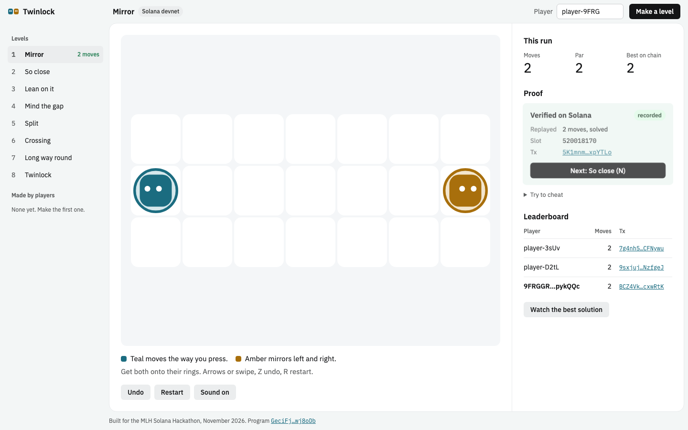
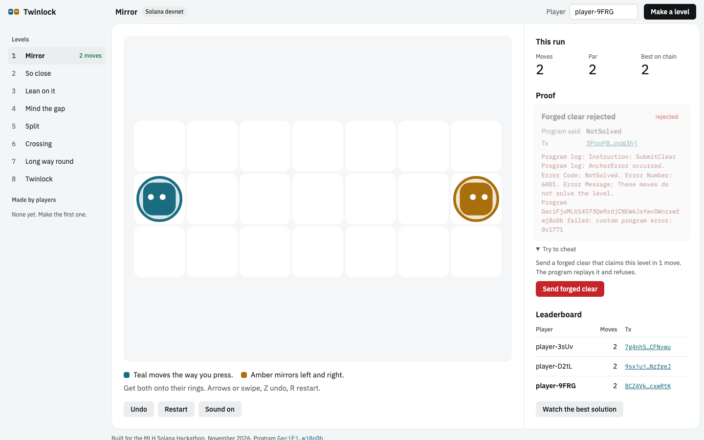

# Twinlock

A puzzle game whose scores are checked by a Solana program.

You move two twins at once. Teal goes the way you press; amber mirrors left and right. Get both onto their pads at the same time. A twin stops when it hits a wall, the edge of the grid or the other twin, and you use those stops to line them up. Pits end the run.

Every solve is sent to the Twinlock program on Solana devnet as a list of moves. The program replays the moves itself, one by one, and only writes a clear to the leaderboard if its own replay ends with both twins on their pads. A client that claims "solved in 1 move" gets a failed transaction with `NotSolved`, which anyone can open in the explorer.

Players can also build levels. A level only gets published if its creator sends a solution the program can replay, so every level on the chain is provably solvable.

- Play: https://links.harindu.dev/twinlock/ (Solana devnet, no wallet needed)
- Program (devnet): [`GeciFjoMLb14573Qw9zdjCNEW6JsYwvDWnzxwfwj8oDb`](https://explorer.solana.com/address/GeciFjoMLb14573Qw9zdjCNEW6JsYwvDWnzxwfwj8oDb?cluster=devnet)





## Why it needs a chain

Online puzzle leaderboards are easy to fake. The server usually trusts whatever score the client sends, or the developer runs their own referee. Twinlock moves the referee into a public program:

- The rules live in the program. `programs/twinlock/src/rules.rs` is the same replay the game uses, and a clear exists only because the program reproduced it.
- Anyone can publish a level, and the program refuses one that has no working solution.
- Levels, clears and best solutions are plain accounts. Another game or site can read them, run a tournament on them or replay a best solution without asking us.
- A clear is one transaction using about 10,000 to 14,000 compute units (measured on a local validator), well under the 200,000 default. Players get a throwaway key in the browser and a sponsor key pays the fees, so there is no wallet pop-up.

## How it works

```
browser                                   Solana program (Anchor)
-------                                   -----------------------
play locally (rules.ts)
solve -> moves packed 2 bits each  --->   submit_clear(moves, n)
                                            replay(level, moves) in rules.rs
                                            ok    -> Clear account (best kept), Level best updated
                                            error -> NotSolved / Fell / ExtraMoves / TooManyMoves
editor: paint, solve your own level --->  publish_level(grid, solution)
                                            validate layout + replay solution, else BadLevel / NotSolved
leaderboard  <---  getProgramAccounts(Clear where level = X)
```

Accounts:

| Account | Seeds | Holds |
|---|---|---|
| `Level` | `"level", creator, id` | grid (up to 8x8), starts, name, par, best moves, best player, clears, best solution |
| `Clear` | `"clear", level, player` | the player's best move count, its solution and slot |
| `Player` | `"player", authority` | display name |

Rules (identical in Rust and TypeScript, both tested against `fixtures/levels.json`):

- A move is up, down, left or right. Teal moves that way; amber moves the same way vertically and the opposite way horizontally.
- A twin facing a wall or the edge stays put. If both twins would end on the same cell, or swap cells, neither moves.
- Landing in a pit ends the run. Both twins on their pads ends it with a win; extra moves after that are rejected.
- At most 64 moves, packed 4 to a byte.

## Run it

Needs Rust, the Solana CLI (Agave 4.x), Anchor 1.2.2 and Node 22+.

```bash
anchor build
cargo test                      # rules fixtures + program tests on LiteSVM
cd web && npm install
npm test                        # TypeScript rules, solver, level checks
../scripts/e2e.sh               # local validator: publish, clear, forged clear, leaderboard
npm run dev                     # play against devnet, or set VITE_RPC in web/.env.local
node tests/smoke.mjs            # browser test against the dev server (Playwright)
```

`scripts/deploy-devnet.sh` deploys the program, funds the fee sponsor and publishes the eight official levels.

## What is in the repo

| Path | What |
|---|---|
| `programs/twinlock/src/rules.rs` | the replay, no Anchor dependency |
| `programs/twinlock/src/lib.rs` | `publish_level`, `submit_clear`, `set_name` |
| `programs/twinlock/tests/` | LiteSVM program tests and the shared fixture test |
| `fixtures/levels.json` | rule cases both implementations must pass |
| `web/src/rules.ts`, `solver.ts` | the same rules in TypeScript, and a breadth-first solver used for par and the editor |
| `web/src/chain.ts` | transactions and account reads with `@solana/kit`, no generated client |
| `web/src/game.ts`, `main.ts` | canvas board, input, editor, proof panel |
| `web/tools/gen-levels.ts` | the search used to find the official levels |

## Limits

- A valid replay proves the moves solve the level. It does not prove a human found them: a bot running the solver, or someone copying the best solution (which is public on purpose), can post the same score. Ties go to the earlier slot.
- The fee sponsor is a devnet key bundled into the web build so players need no SOL. Anyone could drain it; on mainnet it would sign behind a small server instead.
- Devnet only. There is no token and nothing to buy.

## Built with

Solana (devnet), Anchor 1.2.2, LiteSVM, `@solana/kit` 8.6, Vite, TypeScript, Playwright. Sounds are synthesized in the browser with WebAudio; there are no third-party art or audio assets.

AI tools: the code, levels search tooling and this README were written with Claude (Anthropic) as a coding assistant, as the MLH rules ask entrants to disclose.

Made for the MLH Solana Hackathon, 6-8 November 2026.
